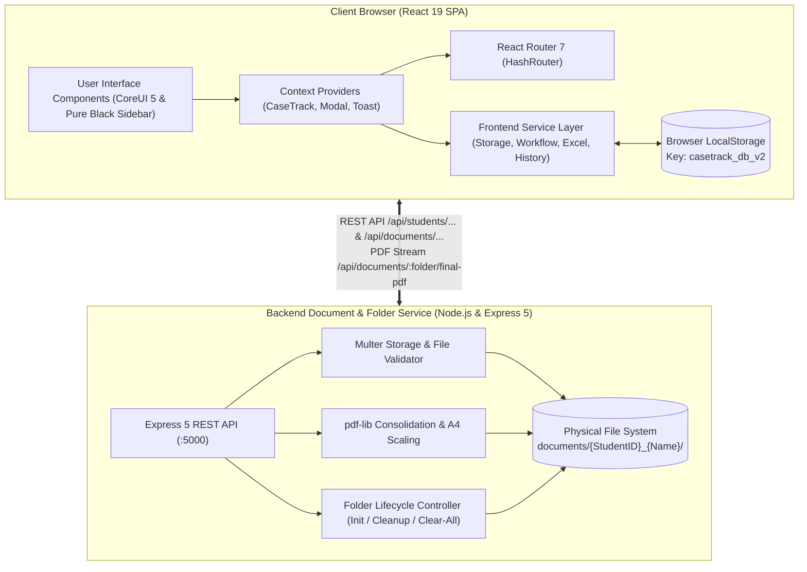
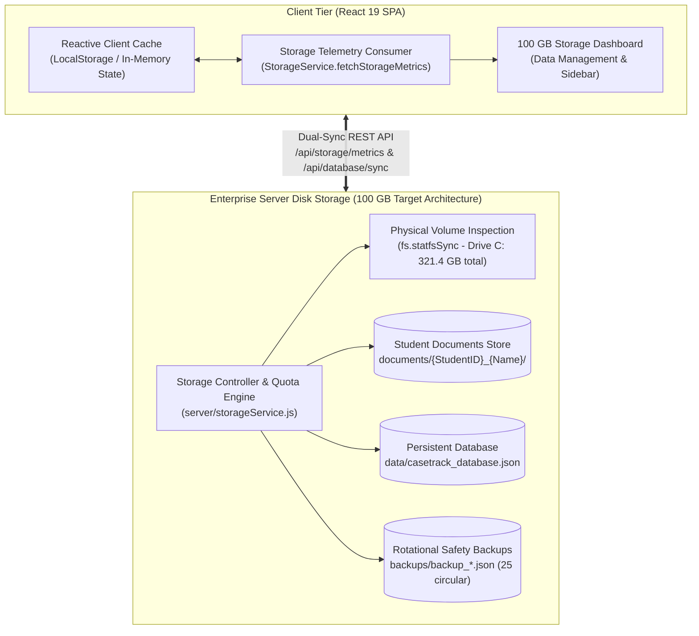

# CaseTrack - Technical System Architecture
### Architectural Specification & Engineering Blueprint (v2.2.0)

This document provides a comprehensive architectural overview of the **CaseTrack** Student Degree and Transcript Tracking application, documenting frontend component hierarchies, state management, service layer, backend document engine, deletion safety architecture, and build pipeline.

---

## 1. High-Level System Architecture

CaseTrack employs a modern decoupled architecture: a reactive Single Page Application (SPA) on the frontend paired with an Express 5 backend service for physical document processing, RESTful folder management, and PDF consolidation.



---

## 2. Frontend Application Architecture

### 2.1 Provider Hierarchy (`src/main.jsx`)
The application wraps all views in a deterministic, top-down context hierarchy:

```jsx
<React.StrictMode>
  <ToastProvider>           {/* Non-blocking operational notifications */}
    <CaseTrackProvider>     {/* Master state: students, stats, settings, branding, storage sync */}
      <AuthProvider>        {/* Authentication, session tokens & RBAC permissions */}
        <ModalProvider>     {/* Centralized modal dialog manager */}
          <HashRouter>      {/* URL routing with hash fragment compatibility */}
            <App />         {/* Protected & public route switch */}
          </HashRouter>
        </ModalProvider>
      </AuthProvider>
    </CaseTrackProvider>
  </ToastProvider>
</React.StrictMode>
```
    </CaseTrackProvider>
  </ToastProvider>
</React.StrictMode>
```

### 2.2 Route Code-Splitting & Lazy Loading (`src/App.jsx`)
All route views are code-split using `React.lazy()` and wrapped in a global `Suspense` boundary with an `ErrorBoundary`. This guarantees fast initial page loads and isolates heavy dependencies into on-demand chunks.

| Route Path | Component | Chunk Output | Purpose |
| :--- | :--- | :--- | :--- |
| `/dashboard` | `DashboardPage` | `DashboardPage-*.js` | Analytics, stat widgets & program distribution |
| `/students/:stage` | `StudentCasesPage` | `StudentCasesPage-*.js` | Dedicated stage-wise case tables with workflow actions |
| `/history` | `HistoryPage` | `HistoryPage-*.js` | Complete immutable audit log |
| `/data-management` | `DataManagementPage` | `DataManagementPage-*.js` | Modernized 4-card Excel & JSON data management center |
| `/settings` | `SettingsPage` | `SettingsPage-*.js` | System preferences & dark/light theme |

### 2.3 Component & Layout Hierarchy

```
AppLayout
├── AppSidebar (Pure Black #000000, badges, storage gauge, collapse toggle)
├── AppHeader (Mobile hamburger, quick search Ctrl+K, theme toggle, notifications, profile)
└── Main Content Container
    ├── StageWorkflowNav (Horizontal sub-navigation across stages)
    ├── Page Component (Dashboard, StudentCases, History, DataManagement, Settings)
    └── Global Modals (Mounted at root level via ModalContext)
        ├── DocumentUploadWizardModal (4-step multi-upload wizard)
        ├── ViewDocumentsModal (In-browser consolidated PDF viewer)
        ├── StudentFormModal (Create / Edit student information)
        ├── ReturnCaseModal (Enforced return reason dialog)
        ├── ViewStudentModal (Demographics & full workflow history)
        ├── HistoryModal (Per-student activity audit log)
        ├── QuickSearchModal (Instant Ctrl+K jump search)
        ├── DeleteConfirmationModal (Single-record safe deletion dialog)
        └── ConfirmModal (Bulk action & Purge confirmation dialogs)
```

### 2.4 Performance Optimization & Memoization
Heavy data-grid tables are wrapped with `React.memo` and utilize `useMemo` for filtering and sorting to eliminate redundant re-renders:
- **`StudentRecordsTable`**: Memoized table component supporting 6 dynamic column configurations depending on the active stage.
- **`HistoryTable`**: Memoized activity log grid with color-coded audit badges.
- **`ProgramReportTable`**: Memoized aggregate statistics table grouped by academic program.

---

## 3. Service Layer Architecture

The frontend service layer encapsulates business logic cleanly away from UI components:

### 3.1 `StorageService.js` (Persistence Layer)
- Manages reading, writing, and backup recovery from browser `LocalStorage` using the key `casetrack_db_v2`.
- Maintains a mirror backup under `casetrack_db_v2_last_valid_backup` that automatically restores state if JSON corruption occurs.
- Implements strict schema validation (`validateDatabaseSchema`) ensuring all student records contain unique Student IDs and non-null required fields.
- Calculates storage quota consumption and warns users when nearing browser boundaries.
- Provides defensive zero-record immunity: when the student database is empty, all metrics, completion rates, and turnaround calculations cleanly return default values without runtime exceptions.

### 3.2 `WorkflowService.js` (State Machine Engine)
Implements a pure functional sequential state machine:
- **Guards**: `canMarkReady()`, `canSendInitial()`, `canReturnCase()`, `canResendCase()`, `canMarkReceived()`, `canDeleteStudent()`.
- **Transitions**:
  - `markCaseReady()`: Moves student from Stage 0 (Pending) to Stage 1 (Case Ready). **Document upload is optional**: students with or without uploaded files can be marked ready. Sets `caseReady` timestamp.
  - `sendToMainCampus()`: Validates dispatch eligibility, appends `sendHistory` attempt, increments attempt counter.
  - `returnCase()`: Validates active sent status, enforces mandatory return reason (minimum 5 characters), records `returnedAt`.
  - `markReceived()`: Permanently locks record, sets `received` completion timestamp.
- **Audit Logging**: Every transition automatically appends an immutable audit event to `activityHistory`.

### 3.3 `ExcelService.js` (Spreadsheet Engine)
- Utilizes SheetJS (`xlsx`) for client-side binary parsing.
- Features **flexible column synonym matching** (e.g. accepts `Student ID`, `Roll No`, `Reg No`, `Student #` for the ID field; accepts `Date Request`, `Apply Date`, `Application Date` for the application date).
- Automatically handles real university Odoo Excel files:
  - Detects the actual header row even if preceded by metadata rows.
  - Automatically splits combined Student ID and Name columns (`IU04-0322-0490 Syeda Yusra Erum`).
  - Correctly parses ISO strings, localized date formats, and Excel numeric serial dates.
- Supports three duplicate collision strategies:
  1. *Skip Duplicates* (preserves existing records).
  2. *Update Basic Info* (updates student name/program without altering existing workflow history or timestamps).
  3. *Abort & Report* (flags errors for administrative inspection).
- Generates formatted Excel files with multiple worksheets (`Student Records` and `Workflow History`).

---

## 4. Backend Document & Folder Architecture

The Node.js and Express backend service (`server.js` and `server/documentService.js`) provides persistent physical file storage, RESTful folder management, and document consolidation.

### 4.1 Folder Hierarchy on Disk
When student documents are uploaded, the backend automatically initializes an organized directory structure under `documents/`:

```
documents/
└── {StudentID}_{StudentName}/
    ├── transcripts/
    │   ├── EDP_Transcript.pdf
    │   └── Exam_Transcript.pdf
    ├── academic_documents/
    │   ├── Matric_Certificate.pdf
    │   ├── Intermediate_Marksheet.pdf
    │   └── Intermediate_Certificate.pdf
    ├── Additional_Degrees/
    │   ├── Bachelor_Transcript.pdf
    │   └── Master_Degree.pdf
    └── Final_Student_Document.pdf    <-- Automated consolidated output
```

### 4.2 Document Processing Pipeline
1. **Upload & Inspection**:
   - Files arrive via `multipart/form-data`.
   - Multer streams files into the student's designated folder.
   - Files are validated against a 15MB size limit and verified to be genuine PDFs via magic byte inspection (`%PDF-` header check).
2. **Consolidation Engine (`pdf-lib`)**:
   - The engine opens every uploaded PDF in sequential order: Transcripts → Academic Certificates → Additional Degrees.
   - For every page in every source document, the engine calculates the aspect ratio and scales it to fit standard **A4 dimensions (595.28 x 841.89 points)**.
   - All pages are merged into a single document and saved to disk as `Final_Student_Document.pdf`.
3. **Serving & Streaming**:
   - The consolidated PDF is served via `GET /api/documents/:folder/final-pdf` with inline `Content-Disposition` for instant in-browser viewing, downloading, and printing.

### 4.3 Folder Lifecycle REST API Endpoints
- `POST /api/students/init-folder`: Creates a single student's document folder on registration.
- `POST /api/students/init-folders-bulk`: Creates folders in bulk upon Excel batch ingestion.
- `POST /api/students/cleanup-folders`: Safely removes physical folders for deleted student IDs.
- `POST /api/students/clear-all-folders`: Safely empties the `documents/` directory when database purge is executed.
- `DELETE /api/students/:id/documents`: Removes a specific student's folder and files.

---

## 5. Deletion Operations & Safety Architecture

CaseTrack implements a 3-tier deletion architecture ensuring zero data loss and robust confirmation:

1. **Individual Record Deletion**:
   - Triggered via action button in student tables.
   - Requires explicit confirmation via modal dialog.
   - Safely removes student record from LocalStorage and issues `cleanup-folders` call to Express backend.
2. **Selected Records Bulk Deletion**:
   - Allows selecting multiple candidate students via checkboxes in Data Management.
   - Shows candidate preview with student names and programs.
   - Requires confirmation dialog before execution.
3. **Clear All Student Data (Purge)**:
   - Destructive operation protected by mandatory exact-string typing: `DELETE ALL STUDENT DATA`.
   - Automatically downloads an offline JSON backup (`casetrack_safety_backup_*.json`) before purging.
   - Purges all student records and dispatches, resets metrics, clears backend document folders, and preserves operator profile, campus branding, and system preferences.

---

## 6. Build & Bundling Architecture

Vite 6 is configured with Rollup manual chunking to ensure optimal caching and minimal transfer overhead:

```javascript
// vite.config.js
export default defineConfig({
  plugins: [react()],
  build: {
    rollupOptions: {
      output: {
        manualChunks: {
          "vendor-react": ["react", "react-dom", "react-router-dom"],
          "vendor-xlsx": ["xlsx"]
        }
      }
    }
  }
});
```

### Production Build Profile:
- **`dist/index.html`**: 1.15 kB
- **`dist/assets/vendor-react-*.js`**: 51.84 kB (Core React framework)
- **`dist/assets/vendor-xlsx-*.js`**: 424.84 kB (Isolated SheetJS chunk)
- **`dist/assets/index-*.js`**: 321.17 kB (Core application shell)
- **Page chunks**: 6 kB – 40 kB each, loaded on demand via Suspense.
- **CSS Bundle**: 398.30 kB (CoreUI 5 + Bootstrap Icons) + 6.73 kB (`DataManagementPage.css`).

---

## 7. Enterprise 100 GB Storage Architecture & Telemetry

CaseTrack implements an enterprise-grade multi-tier storage architecture designed to support a target storage capacity of **100 GB** without degrading client performance or exceeding browser sandboxes:



### 7.1 Multi-Tier Storage Partitioning
1. **Student Documents (`documents/`)**:
   - Accommodates high-resolution academic transcripts, certificates, degrees, and consolidated PDFs.
   - Per-file upload limit upgraded to **100 MB** (Express body limit 100 MB).
   - Real disk bytes measured recursively and reported live.
2. **Server-Side Persistent Database (`data/casetrack_database.json`)**:
   - Master persistent database stored directly on server disk.
   - Dual-synchronized on every state mutation via `POST /api/database/sync`.
   - Written atomically using temporary swap files to prevent corruption.
3. **Automated Safety Backups (`backups/`)**:
   - Automated rotational snapshot taken before every server database write.
   - Automated circular pruning retains the 25 most recent backups.
   - Downloadable and restorable via `/api/storage/backups`.
4. **Physical Volume Verification & Dynamic Available Space**:
   - System queries host volume (`fs.statfsSync`) to confirm Drive supports the 100 GB quota.
   - Available space is dynamically computed as:
     $$\text{AvailableBytes} = \min(\text{TargetQuota} - \text{UsedBytes}, \text{PhysicalDriveFreeBytes})$$
   - Prevents artificial limits or false claims by reflecting live disk truth.
5. **Pre-Check Capacity Guard**:
   - `checkStorageAvailable(incomingBytes)` runs before file writes to prevent storage overruns and preserves a mandatory 50 MB safety buffer on disk.
