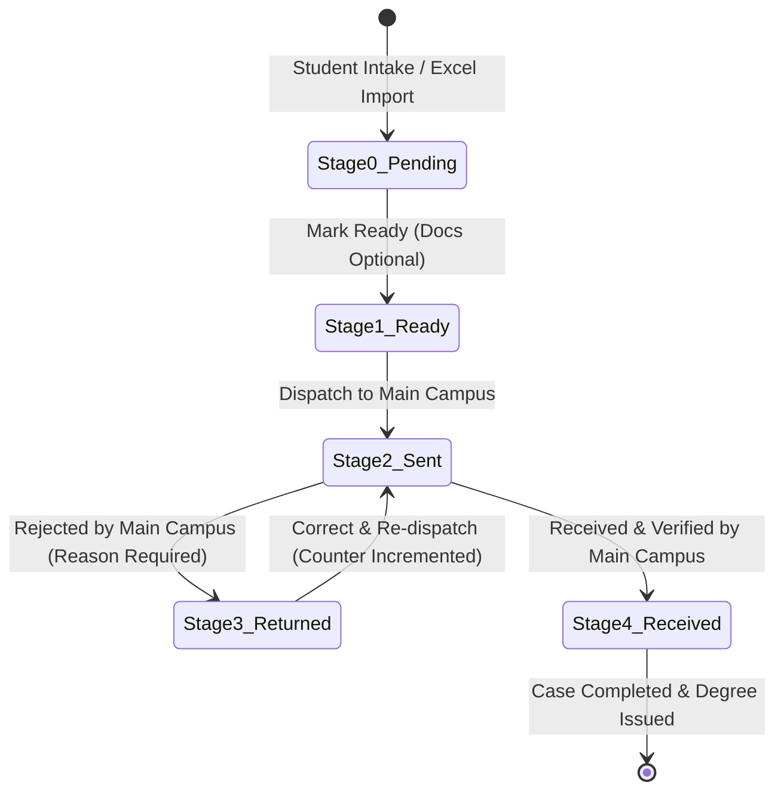

# CaseTrack - Student Degree & Transcript Workflow Management System
### University Administrative Platform (v2.5.0 Production)

CaseTrack is an enterprise-grade administrative web application purpose-built for university campus management. It automates, coordinates, and tracks student degree and transcript applications through a strict 4-stage sequential workflow: **Pending (Stage 0)**, **Case Ready (Stage 1)**, **Sent to Main Campus (Stage 2)** (with documented return and resend tracking), and **Received from Main Campus (Stage 3)**.

Built with a high-performance **React 19**, **Vite 6**, and **Node.js/Express** architecture, CaseTrack combines client-side reactivity and LocalStorage persistence with an automated backend document management and PDF consolidation engine, native cryptographic authentication (Node.js `scrypt`), Dynamic Institutional Branding, and Role-Based Access Control (RBAC).

---

## Key Highlights & Core Capabilities

- **Dynamic CaseTrack Branding & Institutional Identity**:
  - Customize system brand name, subtitle, and institutional logo (PNG, JPG, JPEG, SVG, ICO) with live dual-context previews (Sidebar header and browser tab).
  - Immediate reactive DOM update for Document Title and Browser Favicon (`<link rel="icon">`) without page refreshes.
  - Full persistence across client storage and server REST endpoints (`/api/branding`). One-click restore to factory defaults.
- **Enterprise User Management & Role-Based Access Control (RBAC)**:
  - First-class User Management interface (`/users`) under **ADMINISTRATION** with interactive User Directory and Role Permissions Matrix.
  - Complete user lifecycle: account creation, profile edits, role assignments, password resets, and user deletion.
  - Strict security guards preventing administrators from deleting their own active accounts or removing the final active Super Admin.
  - 4 pre-configured operational tiers: **Super Admin**, **Admin Officer**, **Registrar Desk**, and **Auditor (Viewer)**.
- **Cryptographic Authentication & Session Gateway (`/login`)**:
  - Secure login portal featuring dynamic university branding, password visibility toggle, error notifications, and 1-click test credential pills.
  - Password hashing utilizing native Node.js `scryptSync` with 16-byte cryptographically random salt and timing-safe equality verification (`timingSafeEqual`).
  - Protected React routing with `ProtectedRoute`, permission verification (`hasPermission()`), and loading fallback guards.
- **Universal Table Text-Wrapping & Layout Perfection (`GlobalTableLayout.css`)**:
  - Enforced `overflow-wrap: break-word` and `word-break: break-word` preventing text clipping on long student IDs, student names, degree titles, and return reasons.
  - Clean container fit across Desktop Large (1920px), Standard (1440px), Laptop (1366px), Tablet, and Mobile viewports.
- **100 GB Multi-Tier Storage Volume**:
  - Support for 100 GB storage capacity for student dossiers, scanned transcripts, compiled PDFs, and automated rotational backups.
  - Multi-tier storage calculation and live quota telemetry across sidebar and settings.

- **Modern React 19 & Vite 6 Architecture**:
  - Fully componentized frontend utilizing React 19, React Router 7 (`HashRouter`), Context API state management, and code-split routes via `React.lazy` and `Suspense`.
  - Zero-configuration production bundling with custom vendor chunking (`vendor-react`, `vendor-xlsx`).
- **4-Stage Workflow State Machine**:
  - **Stage 0 (`Pending Cases`)**: Student intake, document staging, and graduation eligibility verification.
  - **Stage 1 (`Case Ready Queue`)**: Cases verified and ready for dispatch. Supports both documented cases and an optional document workflow.
  - **Stage 2 (`Sent to Main Campus`)**: Active dispatches awaiting receipt confirmation. Supports structured case returns with mandatory documented audit reasons and tracked resend attempts.
  - **Stage 3 (`Received / Completed`)**: Permanently locked, completed student cases received back from Main Campus.
- **Flexible Document Upload & Optional Mark Ready Workflow**:
  - Supports full document uploading with automated A4 PDF compilation (`Final_Student_Document.pdf`) while preserving original certificates.
  - **Optional Document Workflow**: Administrators can mark students Ready directly without document uploads when physical verification is handled offline.
- **Advanced Odoo Excel File Ingestion**:
  - Automatically identifies header rows, handles merged or compound Student ID / Name columns (`IU04-0322-0490 Syeda Yusra Erum`), resolves ISO and serial date formats, and tracks duplicates.
- **Modernized Data Management Center**:
  - 4 modular cards: **Excel Upload & Data Ingestion**, **Excel Data Export**, **JSON Database Backup & Restore**, and **Database Maintenance & Operations**.
  - Defensive individual and bulk record deletion with safe backend folder purging.
  - Multi-tier destructive operation protection with exact string confirmation (`DELETE ALL STUDENT DATA`) and automated safety backups.
- **CoreUI 5 Design System & Pure Black Sidebar**:
  - High-contrast pure black sidebar (`#000000`) with white typography and active navigation badges.
  - Signature university purple branding (`#5856d6`) with full Light and Dark theme switching and automatic LocalStorage persistence.
  - 100% responsive layout across 13 device viewports (from 1920px large desktops down to 320px compact phones) with zero horizontal overflow.

---

## Technology Stack

| Layer | Technologies | Description |
| :--- | :--- | :--- |
| **Frontend Framework** | React 19.0.0, ReactDOM 19.0.0 | Component hierarchy, Hooks, Context API |
| **Routing** | React Router DOM 7.1.1 | HashRouter for zero-config static hosting |
| **Build Tool & Bundler** | Vite 6.0.5 | ES module bundler, manual vendor chunk splitting |
| **Backend & APIs** | Node.js (v20+), Express 5.3.0 | REST API endpoints, folder lifecycle, PDF streaming |
| **Document Processing** | `pdf-lib` 1.17.1, Multer 2.5.0 | Multipart file uploads, PDF validation & compilation |
| **Spreadsheet Engine** | SheetJS (`xlsx` 0.18.5) | Ingestion of Odoo exports and multi-sheet exports |
| **Design & UI System** | CoreUI 5 CSS, Bootstrap Icons 1.11.3 | Semantic color tokens, pure black sidebar, dark mode |
| **Quality Assurance** | Native Node.js Test Suites | 11 comprehensive automated test suites |

---

## Directory Structure

```
Degree and Transcript App/
├── css/
│   ├── responsive.css             # Viewport breakpoints (13 device viewports)
│   └── style.css                  # CoreUI 5 tokens, dark/light themes, sidebar tokens
├── dist/                          # Production build output (generated by Vite)
├── documentation/                 # Technical documentation & guides
│   ├── RESPONSIVE_DESIGN_GUIDE.md # 13-viewport responsive architecture
│   ├── THEME_SYSTEM_DOCUMENTATION.md # CoreUI 5 dark/light tokens & styling
│   ├── WORKFLOW_DOCUMENTATION.md  # 15-step student lifecycle state machine
│   ├── DOCUMENT_MANAGEMENT_GUIDE.md # Storage structure & PDF compilation
│   ├── EXCEL_IMPORT_EXPORT_GUIDE.md # Odoo format & flexible column mapping
│   ├── BACKUP_AND_RESTORE_GUIDE.md # JSON backup, restore & factory reset
│   ├── TESTING_AND_QA_REPORT.md   # Test suite documentation & coverage
│   ├── SECURITY_AND_DATA_INTEGRITY.md # Data protection & deletion safety
│   ├── SYSTEM_AUDIT_REPORT.md     # 12-phase complete technical audit
│   └── KNOWN_ISSUES.md            # Documented boundaries & recommendations
├── documents/                     # Physical file storage for student PDF folders
│   └── {StudentID}_{StudentName}/
│       ├── transcripts/           # EDP & Exam Transcripts
│       ├── academic_documents/    # Matric & Inter Certificates
│       ├── Additional_Degrees/    # B.Com, BA, etc.
│       └── Final_Student_Document.pdf
├── server/
│   └── documentService.js         # Backend document storage, validation & PDF compilation
├── src/
│   ├── App.jsx                    # Root routes with Suspense & lazy loading
│   ├── main.jsx                   # React 19 entry point and provider hierarchy
│   ├── components/
│   │   ├── common/                # Badge, EmptyState, Pagination, ErrorBoundary
│   │   ├── layout/                # AppLayout, AppHeader, AppSidebar, StageWorkflowNav
│   │   ├── modals/                # Document Upload Wizard, ViewDocumentsModal, etc.
│   │   └── tables/                # StudentRecordsTable, HistoryTable, ProgramReportTable
│   ├── context/
│   │   ├── CaseTrackContext.jsx   # Master state provider (students, stats, settings)
│   │   ├── ModalContext.jsx       # Global modal manager (7 operational modals)
│   │   └── ToastContext.jsx       # Non-blocking notification toasts
│   ├── pages/
│   │   ├── DashboardPage.jsx      # Metrics overview & program distribution
│   │   ├── DataManagementPage.jsx # Modernized 4-card data ingestion & maintenance
│   │   ├── DataManagementPage.css # Page-scoped modular card styling
│   │   ├── HistoryPage.jsx        # Complete audit trail & event log
│   │   ├── SettingsPage.jsx       # Profile & appearance preferences
│   │   └── StudentCasesPage.jsx   # Dedicated stage-wise case tables
│   ├── services/
│   │   ├── ExcelService.js        # Flexible spreadsheet parsing and generation
│   │   ├── HistoryService.js      # Immutable audit trail management
│   │   ├── StorageService.js      # LocalStorage persistence & schema validator
│   │   └── WorkflowService.js     # 4-stage state machine & transition rules
│   └── utils/
│       ├── dateUtils.js           # Timezone-safe date parsing & formatting
│       ├── formatters.js          # Currency, status strings, IDs, search helpers
│       └── validators.js          # Student ID, CNIC, and phone regex validation
├── tests/                         # Automated test suites
├── server.js                      # Express backend document and API server
├── package.json                   # Project scripts and dependencies
└── vite.config.js                 # Vite build & chunk configuration
```

---

## Getting Started

### Prerequisites

- **Node.js**: v20.0.0 or higher
- **npm**: v10.0.0 or higher
- **Google Chrome**: (Optional, for running headless browser E2E test suites)

### Installation

```bash
# Install dependencies
npm install
```

### Running the Application

CaseTrack operates as a cohesive full-stack application:

```bash
# Option 1: Start the Express Backend Server (Port 5000)
# Serves both the REST API and the production React frontend build
npm start

# Option 2: Start Vite Development Server with Hot Module Replacement (Port 3000)
npm run dev
```

Visit the application in your browser:
- Express Production Server: [http://localhost:5000](http://localhost:5000)
- Vite Dev Server: [http://localhost:3000](http://localhost:3000)

---

## Building for Production

```bash
npm run build
```

The production assets will be built in the `dist/` directory.

---

## Automated Test Suites

CaseTrack includes an exhaustive automated test suite covering unit logic, state machines, REST APIs, Excel parsing, deletion safety, and real headless browser responsive viewports:

```bash
# Run all test suites sequentially
npm run test:all

# Individual test suites:
npm run test           # Storage normalization & workflow state machine tests
npm run test:excel     # Real Odoo Excel ingestion & header detection
npm run test:mark-ready # Optional document upload & Mark Ready workflow
npm run test:delete    # Deletion operations & zero-record immunity
npm run test:dm-resp   # Data Management responsive test (9 viewports)
npm run test:integrity # All 10 application pages rendering integrity
npm run test:audit     # Full system-wide audit suite (13 viewports & themes)
npm run test:pending   # Pending cases table width optimization
npm run test:tables    # Global table layout audit across all pages
npm run test:storage   # 100 GB storage architecture, disk telemetry & dashboard
```

---

## System Workflows



---

## License & University Rights

&copy; 2026 Iqra University. All rights reserved. Developed for academic administration and registrar operations.
