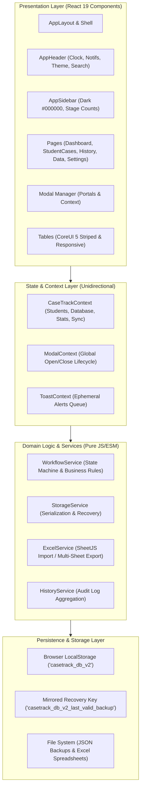

# 03 - System Architecture

**Application:** CaseTrack - Student Case Management System  
**Organization:** Iqra University  
**Technology Stack:** React 19, Vite 6, React Router 7, Bootstrap Icons, CoreUI 5 Styling  

---

## 1. High-Level Architecture Overview

CaseTrack is designed as a high-reliability, zero-latency Client-Side Single Page Application (SPA). Because university campus operators frequently need to process degree clearances in environments with intermittent internet connectivity, the application operates entirely client-side with single-device browser `LocalStorage` as its primary persistence engine.

### Layered Architecture Diagram



---

## 2. Layer Responsibilities

### A. Presentation Layer (`src/components/`, `src/pages/`)
- **Functional Components:** All UI elements are pure functional React 19 components using hooks.
- **Strict Separation of Concerns:** UI components do not perform direct localStorage calls or format business timestamps manually. They delegate to Context hooks (`useCaseTrack()`, `useModals()`, `useToast()`) and utility formatters.
- **Responsive Layout:** Responsive container grid using CoreUI 5 CSS tokens, with mobile off-canvas drawer navigation and desktop sidebar toggling.

### B. State Management Layer (`src/context/`)
- **`CaseTrackContext.jsx`:** The centralized store managing the single-source-of-truth database object. Exposes memoized computed statistics (`stats`), normalized student records, and dispatch methods. Automatically synchronizes all state mutations to `LocalStorage`.
- **`ModalContext.jsx`:** Manages the visibility and payload state for all 7 application dialogs (`StudentFormModal`, `ViewStudentModal`, `ReturnCaseModal`, `HistoryModal`, `RestoreConfirmModal`, `WipeConfirmModal`, `QuickSearchModal`). Modals are rendered at the root layout level, eliminating z-index nesting bugs.
- **`ToastContext.jsx`:** Provides non-blocking feedback toasts for actions (success, danger, warning, info) with automatic 4-second timeout dismissal.

### C. Domain Logic Layer (`src/services/`)
- **`WorkflowService.js`:** Enforces the strict 4-stage sequential state machine:
  $$\text{Pending} \xrightarrow{\text{Mark Ready}} \text{Case Ready} \xrightarrow{\text{Send}} \text{Sent to Main Campus} \underset{\text{Resend}}{\overset{\text{Return}}{\rightleftharpoons}} \text{Returned Case} \xrightarrow{\text{Receive}} \text{Received (Completed)}$$
  Enforces return reason length requirements ($\ge 5$ characters), tracks resend attempt counters, logs immutable audit entries, and determines deletion locks.
- **`StorageService.js`:** Encapsulates JSON serialization, schema validation, duplicate detection, corrupted data recovery, and quota monitoring.
- **`ExcelService.js`:** Encapsulates SheetJS operations, flexible column synonym mapping, template generation, and multi-sheet reporting.
- **`HistoryService.js`:** Consolidates audit trails across student records and database events into a unified chronological log.

---

## 3. Component Hierarchy

```
<ToastProvider>
  <CaseTrackProvider>
    <ModalProvider>
      <HashRouter>
        <AppLayout>
          ├── <AppSidebar />
          ├── <div className="main-content">
          │     ├── <AppHeader />
          │     ├── <AppBreadcrumb />
          │     ├── <main>
          │     │     <Routes>
          │     │       ├── /dashboard          -> <DashboardPage />
          │     │       ├── /students/:stage    -> <StudentCasesPage />
          │     │       ├── /history            -> <HistoryPage />
          │     │       ├── /data-management    -> <DataManagementPage />
          │     │       └── /settings           -> <SettingsPage />
          │     │     </Routes>
          │     │   </main>
          │     └── <footer className="footer" />
          │   </div>
          └── [Global Modals Mounted via ModalContext]
        </AppLayout>
      </HashRouter>
    </ModalProvider>
  </CaseTrackProvider>
</ToastProvider>
```

---

## 4. Architectural Highlights & Optimization

1. **Decoupled Bundling:** Heavy external dependencies such as `xlsx` are isolated in a separate chunk (`vendor-xlsx`, ~424 KB) so the main application code loads instantly (~335 KB).
2. **Safe Local Navigation:** By utilizing `HashRouter`, the application can be opened directly as static HTML files or served from any web server without requiring server-side URL rewrite rules.
3. **Immutability & Audit Trail:** Student records maintain an internal `activityHistory` array and `sendHistory` array that preserve all timestamps and operators throughout the case lifecycle.
