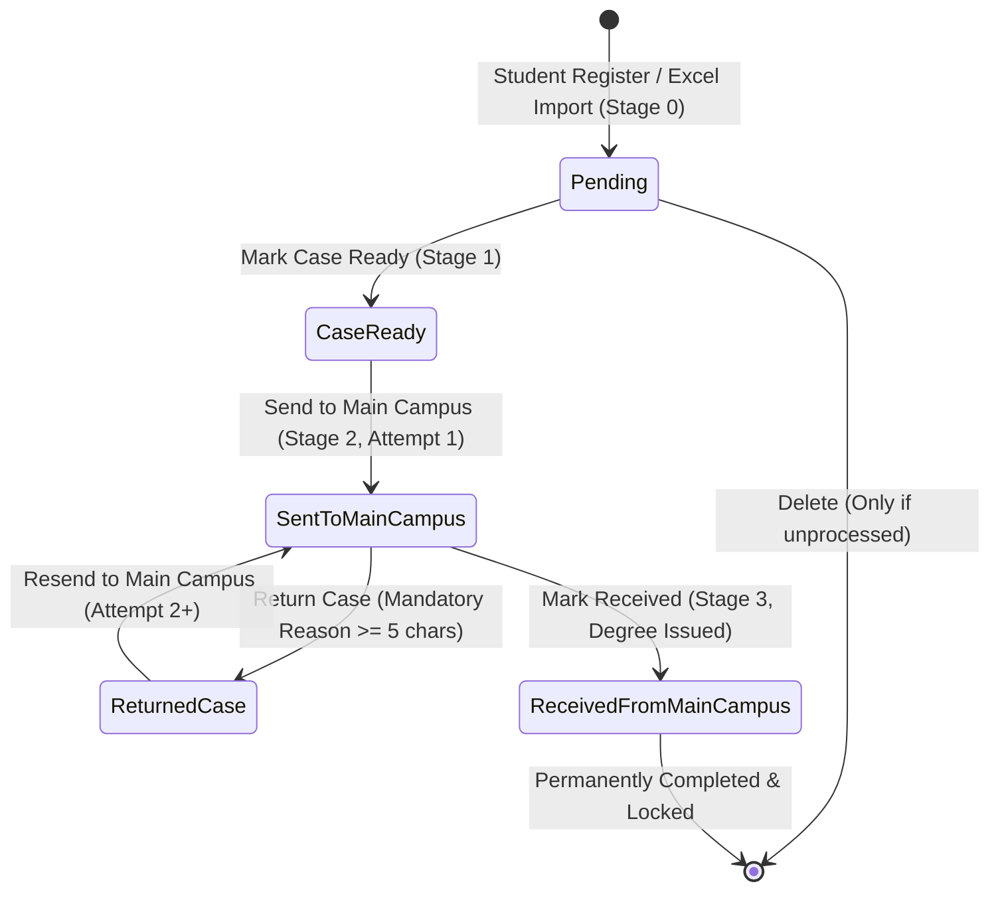

# 06 - Features and Business Workflows

**Application:** CaseTrack - Student Case Management System  
**Organization:** Iqra University  

---

## 1. End-to-End Student Case Lifecycle

CaseTrack automates the verification, dispatch, and tracking of university degree and transcript clearance requests. The lifecycle is strictly enforced through a 4-stage sequential state machine.



---

## 2. Stage Breakdown & Rules

### Stage 0: Pending Cases (`Pending`)
- **Origin:** Created through the manual registration form or bulk-imported via Excel.
- **State Properties:** `caseReady = null`, `sendHistory = []`, `received = null`.
- **Allowed Actions:**
  - View full profile.
  - Edit student demographic and program information.
  - View audit history timeline.
  - Delete record (permitted strictly in this unprocessed state).
  - **Advance:** Click **Mark Ready** to move the case to Stage 1.
- **Restrictions:** Cannot be sent directly to Main Campus. Cannot be marked received.

### Stage 1: Case Ready Queue (`Case Ready`)
- **State Properties:** `caseReady = ISO timestamp`, `status = "Case Ready"`.
- **Allowed Actions:**
  - View full profile.
  - View audit history timeline.
  - **Advance:** Click **Send to Main Campus** to dispatch the physical documents.
- **Restrictions:** Once marked ready, the student record is permanently locked against deletion to ensure audit integrity.

### Stage 2: Sent to Main Campus (`Sent to Main Campus`)
- **State Properties:** Appends new entry to `sendHistory`:
  ```json
  {
    "sentAt": "2026-11-20T10:00:00.000Z",
    "operator": "Admin Officer",
    "notes": "Dispatch Batch 1",
    "returnedAt": null,
    "returnReason": null
  }
  ```
- **Allowed Actions:**
  - **Advance:** Click **Mark Received** when Main Campus returns the verified degree/transcript.
  - **Return:** Click **Return Case** if Main Campus rejects or returns the application for corrections.

### The Return & Resend Cycle (`Returned Case`)
- **State Properties:** The latest entry in `sendHistory` is updated with `returnedAt` and `returnReason`. The record status transitions to `"Returned from Main Campus"`.
- **Validation Rule:** The return reason is strictly mandatory and must be at least 5 non-whitespace characters (e.g., "Library clearance certificate missing").
- **Resend Action:** Operators resolve the identified deficiency and click **Resend to Main Campus**. A new `sendHistory` entry is pushed with the incremented attempt number (`attemptNo = 2, 3, ...`), returning the case to Stage 2 (`Sent to Main Campus`).

### Stage 3: Received Cases (`Received from Main Campus`)
- **State Properties:** `received = ISO timestamp`, `status = "Received from Main Campus"`.
- **Status:** Degree or official transcript has been received at the campus and is ready for student collection.
- **Locking:** Permanently completed. Records cannot be edited, deleted, resent, or returned.

---

## 3. Data Ingestion & Reporting Features

### A. Flexible Excel Spreadsheet Ingestion
Operators can upload standard Excel workbooks (`.xlsx`, `.xls`). CaseTrack inspects headers dynamically and maps common variations:
- Student ID $\leftarrow$ `Roll No`, `Registration No`, `CMS ID`, `Enrollment`, `ID`
- Full Name $\leftarrow$ `Student Name`, `Applicant Name`, `Full Name`, `Name`
- Degree Program $\leftarrow$ `Department`, `Degree`, `Program`, `Major`
- Apply On Date $\leftarrow$ `Application Date`, `Applied On`, `Date Applied`, `Date`

Operators can select duplicate resolution policies:
- **Skip Duplicates:** Leaves existing database records untouched.
- **Overwrite:** Updates demographic details for matching student IDs while preserving workflow stage and timestamps.

### B. Multi-Sheet Comprehensive Excel Export
Clicking **Export Multi-Sheet Excel** downloads an Excel workbook containing:
1. **Executive Summary:** Overview metrics, completion rate %, average turnaround time, and stage counts.
2. **All Students:** Complete database directory with all chronological timestamps.
3. **Pending Cases:** Active Stage 0 queue.
4. **Case Ready Queue:** Stage 1 cases awaiting dispatch.
5. **Sent to Main Campus:** Stage 2 dispatches with attempt numbers and dispatch operators.
6. **Returned Cases:** Full list of returned cases with mandatory reasons.
7. **Received Cases:** Completed cases with turnaround duration.

### C. JSON Database Backup & Disaster Recovery
Operators can download an offline JSON snapshot of their entire campus database. In case of browser clearing, hardware replacement, or system migration, this snapshot can be restored with a single click using **Replace** or **Merge** modes.

---

## 4. Student Document Management & Multi-Step Upload System

### A. Automatic Student-Wise Folder Structure
Upon manual registration or bulk Excel ingestion, a dedicated directory structure is automatically generated in `documents/`:
```text
project/
├── documents/
│   ├── IU04-0319-0302_Simra_Rehan/
│   │   ├── student_information.json
│   │   ├── transcripts/
│   │   │   ├── EDP_Transcript.pdf
│   │   │   └── Exam_Transcript.pdf
│   │   ├── academic_documents/
│   │   │   ├── Matric_Mark_Sheet.pdf
│   │   │   ├── Matric_Board_Certificate.pdf
│   │   │   ├── Intermediate_Mark_Sheet.pdf
│   │   │   ├── Intermediate_Provisional_Certificate.pdf
│   │   │   ├── Graduation_Mark_Sheet.pdf
│   │   │   ├── Degree.pdf
│   │   │   └── Additional_Degrees/
│   │   │       └── MS_Data_Science_123.pdf
│   │   └── Final_Student_Document.pdf
```

### B. 4-Step Multi-Step Upload Wizard
Accessible via **Edit & Upload Documents** in the Pending Cases queue:
1. **Step 1 – Student Information:** Validates student demographics, clearance departments, and notes without duplicate ID creation.
2. **Step 2 – Transcript Attachments:** Mandatory PDF upload of **EDP Transcript** and **Exam Transcript** with binary magic byte validation and inline preview.
3. **Step 3 – Academic Documents:** Upload fields for Matric Mark Sheet, Matric Certificate, Inter Mark Sheet, Inter Certificate, Graduation Mark Sheet, and Degree. Includes dynamic **Add Another Degree** button for multiple additional degrees.
4. **Step 4 – Review & Submit:** Summary of all files and metadata. Generates `Final_Student_Document.pdf` in strict order (Transcripts $\to$ Academic $\to$ Additional Degrees with title page) and unlocks eligibility for **Case Ready**.

### C. Case Ready Queue Document Actions
1. **View Student:** Detailed modal showing student details and clearance metadata.
2. **View Documents:** Interactive modal with side-by-side preview of source files and consolidated PDF.
3. **Download Complete PDF:** Direct download of `{studentId}_{name}_Complete_Documents.pdf`.
4. **Print Documents:** Dedicated print viewer opening the consolidated PDF for direct browser printing without dashboard clutter.
5. **Send to Main Campus:** Dispatches validated clearance package to Main Campus.
