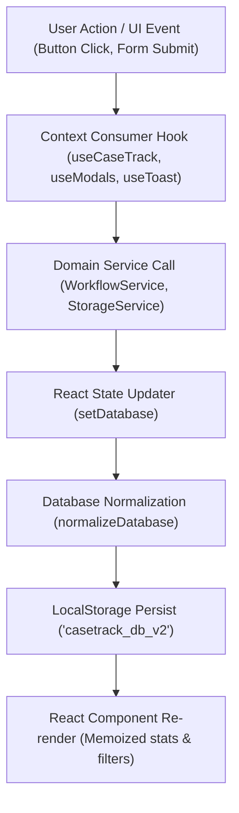

# 07 - Data and State Management

**Application:** CaseTrack - Student Case Management System  
**Organization:** Iqra University  

---

## 1. Centralized State Architecture

CaseTrack manages state through React 19's Context API and pure functional reducers, establishing an immutable, unidirectional data flow that eliminates prop drilling and prevents race conditions.



---

## 2. Context Providers & Interfaces

### A. `CaseTrackContext.jsx`
The primary operational store for students, settings, and application telemetry.

**State Fields:**
- `database`: The complete normalized JSON database object.
- `students`: Derived array of all student records (`database.students`).
- `settings`: System preferences (`campusName`, `operatorName`, `pageSize`, `theme`, `sidebarCollapsed`).
- `notifications`: History of in-app alert logs.
- `stats`: Real-time computed metrics:
  - `counts.total`: Total student count.
  - `counts.pending`: Stage 0 count.
  - `counts.ready`: Stage 1 count.
  - `counts.sent`: Stage 2 active count.
  - `counts.returned`: Current returned cases count.
  - `counts.received`: Stage 3 completed cases count.
  - `counts.totalReturnsLogged`: Cumulative count of all returns in student histories.
  - `completionRate`: Percentage of cases completed (`received / total * 100`).
  - `avgTurnaround`: Average duration in hours/days from `caseReady` to `received`.
  - `programs`: Breakdown of student counts per degree program.

**Key Dispatch Methods:**
- `addStudent(data)`
- `updateStudent(id, data)`
- `deleteStudent(id)`
- `markCaseReady(id)`
- `sendToMainCampus(id, notes)`
- `returnCase(id, reason)`
- `markReceived(id)`
- `importExcelStudents(parsedRows, duplicateHandling)`
- `replaceDatabase(newDbJson)`
- `mergeDatabase(newDbJson)`
- `wipeDatabase()`
- `updateSettings(partial)`

---

### B. `ModalContext.jsx`
Decouples modal presentation logic from individual page trees.

**Exposed Methods:**
- `openStudentForm(student = null)` / `closeStudentForm()`
- `openViewStudent(student)` / `closeViewStudent()`
- `openReturnCase(student)` / `closeReturnCase()`
- `openHistory(student)` / `closeHistory()`
- `openRestoreConfirm(onConfirm)` / `closeRestoreConfirm()`
- `openWipeConfirm(onConfirm)` / `closeWipeConfirm()`
- `openQuickSearch()` / `closeQuickSearch()`

---

### C. `ToastContext.jsx`
Manages a live FIFO queue of notifications with auto-dismissal.

**Signature:**
```javascript
const { addToast, removeToast } = useToast();
addToast("Student record registered successfully.", "success");
```

---

## 3. Data Flow Best Practices

1. **Memoized Calculations:** Derived arrays such as filtered students, sorted students, and program summaries are wrapped in `useMemo` hooks with explicit dependency arrays to maintain 60 FPS UI performance even with thousands of records.
2. **Stable Callback References:** All context mutators are wrapped in `useCallback` to prevent unnecessary child re-renders.
3. **Atomic Persistence:** Changes to students or settings trigger an immediate atomic write to both `casetrack_db_v2` and `casetrack_db_v2_last_valid_backup`, ensuring data durability.
