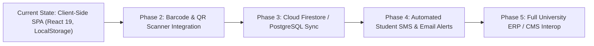

# 16 - Future Development and Extension Guide

**Application:** CaseTrack - Student Case Management System  
**Organization:** Iqra University  

---

## 1. Extension Roadmap



---

## 2. Step-by-Step Extension Recipes

### Recipe A: Adding a New Degree Program
1. Open `src/pages/StudentCasesPage.jsx` and `src/components/modals/StudentFormModal.jsx`.
2. Update the default program select list. Programs are also auto-discovered dynamically from imported records.
3. Update `ProgramReportTable.jsx` if custom program groupings are needed.

### Recipe B: Adding a New Workflow Stage
To add an intermediate stage (e.g., "Dean Clearance Approval"):
1. Open `src/services/WorkflowService.js`.
2. Add the status constant to `STATUS`:
   ```javascript
   export const STATUS = {
     // ...
     DEAN_REVIEW: "Dean Review"
   };
   ```
3. Add stage-checking predicates: `canSendToDean(student)`, `markDeanApproved(student)`.
4. Update `StatusBadge` in `src/components/common/Badge.jsx` with the new badge color and icon.
5. Add the stage filter to `AppSidebar.jsx`, `StageWorkflowNav.jsx`, and `StudentRecordsTable.jsx`.
6. Run `npm test` to verify no regressions in existing stages.

### Recipe C: Integrating Cloud Firestore for Multi-Desk Sync
1. Install Firebase SDK: `npm install firebase`.
2. Create `src/services/FirebaseService.js` initializing the Firestore database.
3. In `src/context/CaseTrackContext.jsx`, replace `StorageService.loadDatabase()` with a real-time Firestore listener:
   ```javascript
   import { onSnapshot, collection } from "firebase/firestore";
   // Listen to updates from other campus workstations
   useEffect(() => {
     const unsub = onSnapshot(collection(db, "students"), (snapshot) => {
       const remoteStudents = snapshot.docs.map(doc => doc.data());
       setDatabase(prev => ({ ...prev, students: remoteStudents }));
     });
     return () => unsub();
   }, []);
   ```
4. Keep `LocalStorage` as an offline cache layer for zero-downtime operation during network drops.

### Recipe D: Barcode & QR Code Scanning
To enable high-speed physical document scanning at the dispatch desk:
1. Install an HTML5 QR/Barcode scanner library (e.g. `html5-qrcode`).
2. Add a scanner trigger button to `AppHeader.jsx` or `StudentCasesPage.jsx`.
3. When a barcode matching a `studentId` is scanned, invoke `openViewStudent(matchedStudent)` or directly call `markCaseReady(matchedStudent.id)`.
