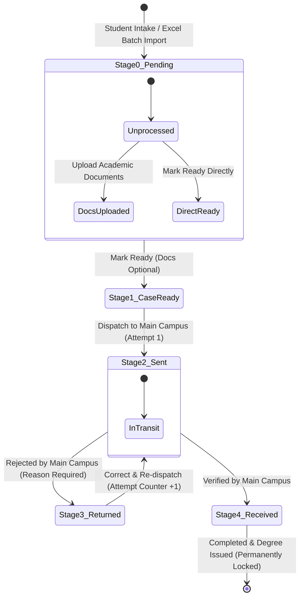

# CaseTrack - Complete Student Workflow & Lifecycle Documentation
### State Machine Transitions, Guards, Audit Logging & 15-Step Lifecycle (v2.2.0)

This document provides complete technical specifications for the sequential state machine governing student case lifecycles in **CaseTrack**.

---

## 1. Workflow Architecture & State Machine

---

## 2. Comprehensive 15-Step Student Lifecycle

### Step 1: Student Record Creation
- Created via the **Add Student** dialog in the top navigation or page header.
- Enforces mandatory Student ID (e.g. `IU04-0322-0490`), Name, Program, and Apply Date.
- Automatically triggers backend REST call `POST /api/students/init-folder` to prepare disk storage.

### Step 2: Excel Bulk Ingestion (Odoo Format)
- Uploaded via Data Management → Excel Upload & Ingestion.
- Automatically identifies the true header row, splits compound Student ID / Name columns (`IU04-0322-0490 Syeda Yusra Erum`), resolves dates, and triggers bulk folder creation (`/api/students/init-folders-bulk`).

### Step 3: Stage 0 (Pending Cases) Intake
- Newly imported or registered students appear in the **Pending Cases** queue.
- Initial status: `pending`, document status: `Not Uploaded`.

### Step 4: Student Details Editing
- Clicking **Edit Student** allows updating name, program, approved departmental clearances, and notes without altering workflow history.

### Step 5: Optional Document Upload & PDF Consolidation
- Clicking **Edit & Upload Docs** launches the 4-step wizard.
- Operator uploads EDP & Exam transcripts, Matric and Inter certificates, and any additional degrees.
- Engine merges files into `Final_Student_Document.pdf` on the server while preserving original files separately.

### Step 6: Mark Ready Workflow
- Operator clicks **Mark Ready** button in Pending Cases.
- **Scenario A (With Documents)**: Validates documents, transitions student to `case_ready`, records `caseReady` timestamp.
- **Scenario B (Without Documents)**: When physical records are processed offline, operator can click Mark Ready directly without uploading digital files. Both scenarios are fully supported.

### Step 7: Stage 1 (Case Ready Queue)
- Student appears in the **Case Ready Queue**.
- Case is cleared and awaiting physical courier batching.
- Document preview, download, and print actions are active.

### Step 8: Batch / Single Dispatch to Main Campus
- Operator clicks **Send to Main Campus**.
- Prompts for courier tracking number / batch reference (optional).

### Step 9: Stage 2 (Sent to Main Campus)
- Transition sets status to `sent` and appends a `sendHistory` attempt entry with timestamp and attempt number (e.g. Attempt #1).

### Step 10: Case Return by Main Campus with Enforced Reason
- If Main Campus rejects a case (e.g. missing credits, name mismatch on matric certificate):
- Operator clicks **Return Case** in Sent to Main Campus table.
- A modal enforces a mandatory return reason (minimum 5 characters). Short or blank reasons are blocked.

### Step 11: Stage 3 (Returned Cases) Action Required
- Student transitions to `returned`.
- Student's total return count is incremented.
- Case appears in **Returned Cases** table with the documented reason highlighted in red.

### Step 12: Correction & Re-dispatch
- Campus staff resolves the discrepancy (e.g. re-uploads corrected marksheet).
- Operator clicks **Resend to Main Campus**.
- Transitions student back to `sent` and increments the attempt counter (e.g. Attempt #2, Attempt #3).

### Step 13: Receipt Confirmation from Main Campus
- When the signed degree and transcript arrive back at campus:
- Operator clicks **Mark Received** in the Sent to Main Campus view.

### Step 14: Stage 4 (Received / Completed) Final Lock
- Student transitions to `received`.
- Records completion timestamp `received` and calculates turnaround time (duration from `caseReady` to `received`).
- Record is permanently finalized. Illegal transitions backwards are blocked by `WorkflowService.js`.

### Step 15: Document Retrieval, Preview, Print & Audit Trail
- Completed student dossier can be opened in the in-app PDF viewer anytime.
- Activity history displays the complete immutable chronological timeline from intake to degree receipt.

---

## 3. Workflow State Transition Guards (`WorkflowService.js`)

| Transition | Guard Method | Prerequisites |
| :--- | :--- | :--- |
| `pending` → `case_ready` | `canMarkReady(student)` | Student ID and Name must be present. (Documents optional) |
| `case_ready` → `sent` | `canSendInitial(student)` | Must be in `case_ready` status. |
| `sent` → `returned` | `canReturnCase(student)` | Must be in `sent` status. Return reason >= 5 characters. |
| `returned` → `sent` | `canResendCase(student)` | Must be in `returned` status. |
| `sent` → `received` | `canMarkReceived(student)` | Must be in `sent` status. |
| Delete Student | `canDeleteStudent(student)` | Permitted for `pending` cases, or with force override. |

---

## 4. Automated Workflow Test Verification

- `tests/verify-react-migration.js`: Validates all state transitions, illegal transition blocks, and duplicate rejection.
- `tests/test-optional-document-mark-ready.mjs`: Tests 10 specific scenarios validating that both with-document and without-document transitions succeed seamlessly.
- `tests/test-complete-workflow-e2e.js`: 16-step integration test validating upload, folder creation, PDF consolidation, dispatch, and history logging.
